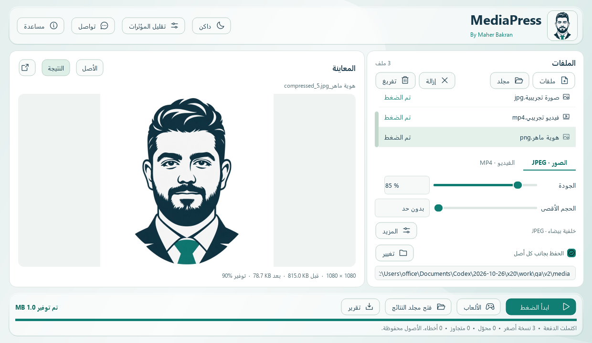

# MediaPress — ضغط الصور والفيديوهات

تطبيق Windows محلي لضغط وتحويل الفيديو إلى **MP4** والصور إلى **JPEG**.

**من تطوير ماهر بكران** · [واتساب +971543386217](https://wa.me/971543386217)

## التنزيل والتشغيل

نزّل حزمة Windows من [الإصدارات](https://github.com/maherbkran/maher-media-compressor/releases/latest)،
فك ضغطها بالكامل وافتح `MediaPress.exe` مع إبقاء `_internal` بجانبه.



## المزايا

- وضع فاتح وداكن، نوافذ متناسقة، وأزرار بإطارات رفيعة ولمعة هوفر متكررة.
- لعبة الدودة والذاكرة، كل منهما بعشرة مستويات، مع تقدم الضغط الفعلي وإعادة فتح اللعبة خلال الجلسة.
- واجهة عربية مدمجة، هوية شخصية، وشريطان زجاجيان مع استجابة ناعمة للأزرار.
- معاينة صور وتشغيل فيديو محلي، وتبديل بين الأصل والنتيجة بأحجامها الفعلية.
- لا تمرير للصفحة؛ قائمة الملفات فقط تتمرر، والأبعاد في نافذة «المزيد».
- إضافة المجلدات والمعاينات في الخلفية، وخيار لتقليل المؤثرات.
- لا حد برمجياً لحجم إدخال الفيديو، ولا مهلة قراءة أو ترميز مفروضة.
- حجم الناتج غير محدود افتراضياً؛ يمكنك تحديده اختيارياً لكل صورة أو فيديو.
- تحكم منفصل بالجودة والعرض والارتفاع، وحفظ تلقائي بجانب كل أصل.
- MP4 / H.264 / AAC للفيديو وJPEG للصور، مع الاحتفاظ بالأصل.
- HEIC/HEIF وAVIF وصيغ الصور الشائعة، وصيغ FFmpeg الشائعة ومنها MOV وMKV وAVI وFLV و3GP وMXF.
- إمكانية اختيار ملف بامتداد غير معروف والتعرف على محتواه؛ الصيغ المقروءة تعتمد على برامج فك الترميز المرفقة.
- حالة وتقدم وإيقاف وتقرير CSV. لا رفع ملفات أو اتصال أثناء الضغط.

JPEG يستبدل الشفافية بخلفية بيضاء. الصور المتحركة ومتعددة الصفحات تصدّر أول إطار/صفحة.
التحويل ضياعي وقد يغيّر الأبعاد ومعدل الإطارات. الملفات التالفة أو المشفرة وبعض الصيغ الخاصة قد لا تُقرأ.
يحتفظ الفيديو بالمسار الأساسي للصورة والصوت. التحويل الكبير يحتاج مساحة ووقتاً وموارد من الجهاز.

## البناء من المصدر

Windows x64، Python 3.14:

```powershell
python -m venv .venv
.venv\Scripts\python.exe -m pip install -r requirements.txt
# Copy _internal/tools from the downloadable release to ./tools first.
.venv\Scripts\python.exe -m unittest test_engine test_ui test_large test_experience test_games -v
.venv\Scripts\python.exe -m PyInstaller MediaPress.spec --noconfirm
```

راجع [BUILD.txt](BUILD.txt) للتفاصيل. ملفات FFmpeg التنفيذية توجد في حزمة الإصدار، ولا تخزّن في Git.

## التحقق

اختبارات فعلية للأدوات والتحويلات والجودة وحدود الناتج والدوران وHDR والأسماء العربية وسلامة الأصول.
`test_large.py` يختبر حاوية فيديو تتجاوز 2 GiB بحشو sparse صالح لعبور حدود الحجم، ومقطع 12 دقيقة،
وصورة فوق حد 256 MB القديم. اختبار الحاوية ليس مقياس أداء لترميز 2 GiB من لقطات فعلية.

المصدر بترخيص MIT. تحتفظ المكتبات المرفقة بتراخيصها؛ راجع `THIRD_PARTY_NOTICES.txt` و`licenses/`.

## الاستخدام

1. أضف ملفات أو مجلداً، ثم اختر ملفاً لمعاينته.
2. اترك الإعدادات الافتراضية، أو اختر 5/10 MB لكل فيديو. افتح «المزيد» لتغيير الأبعاد.
3. ابدأ الضغط، ثم بدّل إلى «النتيجة» وافتح مجلد النتائج.

حجم 5 أو 10 MB هدف اختياري لكل ملف؛ ملاءمة الجودة تعتمد على مدة الفيديو ومحتواه.
المعاينة تدعم الصيغ التي يقرأها المشغّل المرفق؛ تعذّر المعاينة لا يمنع محاولة التحويل.
يتبع تقليل المؤثرات إعداد الشفافية والحركة في Windows عند التشغيل، ويمكن تبديله للجلسة.

[ملاحظات الواجهة والتحقق](docs/verification.md) · [الهوية](docs/brand.md)

تظهر نافذة اختيار اللعبة عند بدء الضغط، ويمكن إغلاقها وفتحها من «الألعاب». اللعب لا يوقف الضغط.
