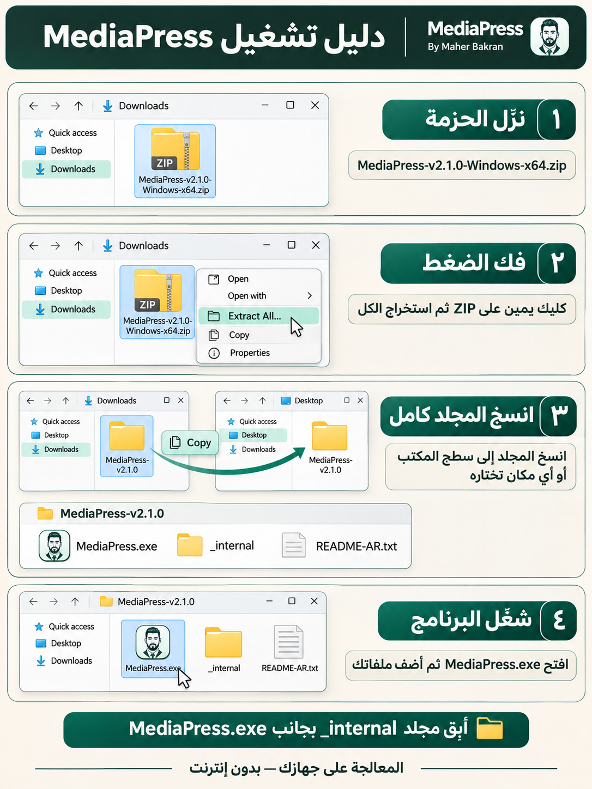

# MediaPress — ضغط الصور والفيديوهات

**By Maher Bakran** · [واتساب +971543386217](https://wa.me/971543386217)

## التنزيل والتشغيل

**[تحميل نسخة Windows الجاهزة — ZIP](https://github.com/maherbkran/maher-media-compressor/releases/download/v2.1.0/MediaPress-v2.1.0-Windows-x64.zip)**

يمكنك أيضاً اختيار **Code → Download ZIP** من هذا المستودع. النسختان تحتويان ملفات التشغيل كاملة.

1. فك الضغط بالكامل، ثم افتح المجلد الذي يحتوي على **MediaPress.exe**.
2. انقل أو انسخ المجلد كاملاً عند الحاجة، مع إبقاء **_internal** بجانب ملف التشغيل.
3. شغّل **MediaPress.exe**. أول مرة يجهّز ملفات التشغيل من الحزمة المحلية تلقائياً، ثم يفتح البرنامج. المرات التالية تفتح النسخة المجهّزة مباشرة.

التجهيز والضغط والمعاينة تعمل بدون إنترنت. لا تحتاج Python أو 7-Zip. التطبيق لويندوز x64، ومشغّل الحزمة يستخدم .NET Framework 4.8 المضمّن في Windows 11 وWindows 10 المحدّث. التحقق الفعلي على Windows 11.

| ما يظهر عند فتح المجلد | وظيفته |
| --- | --- |
| **MediaPress.exe** | تشغيل البرنامج مباشرة |
| **Quick-Start.png** | صورة خطوات فك الضغط والنسخ والتشغيل |
| **اقرأني.txt / README-AR.txt** | دليل عربي مفصّل |
| **_internal** | الحزمة المحلية اللازمة للتشغيل؛ أبقِ جميع ملفاتها معاً |
| **source** | مصدر التطبيق وإرشادات البناء والتراخيص |

يُنشأ **_runtime** محلياً عند التشغيل الأول. لا تحتاج فتحه أو تشغيل ملفات من داخله.

## الاستخدام

أضف صوراً أو فيديوهات، اختر الجودة والحجم والأبعاد، ثم ابدأ الضغط. الفيديو إلى MP4 والصور إلى JPEG؛ النتائج بجانب كل أصل تلقائياً أو داخل مجلد تختاره. الأصول لا تُستبدل.

توجد معاينة ومقارنة صور وتشغيل فيديو، وضع فاتح وداكن، وتقرير نتائج. أثناء الضغط يمكنك لعب الدودة أو الذاكرة بعشرة مستويات وإخفاء نافذتها وفتحها مجدداً.

لا حد برمجياً لحجم إدخال الفيديو. التصدير ضياعي، وملاءمة 5 أو 10 ميغا تعتمد على مدة الملف ومحتواه. الملفات التالفة أو المشفرة أو غير المدعومة قد تتعذر معالجتها دون منع بقية الدفعة.

[الدليل المفصّل](README-AR.txt) · [المصدر والبناء](source/README.md) · [بناء مشغّل الحزمة](source/packaging/README.md) · [التحقق](source/docs/verification.md)

المصدر MIT، والمكونات الأخرى تحتفظ بتراخيصها. راجع [التراخيص](source/licenses/) و[الإشعارات](THIRD_PARTY_NOTICES.txt).
